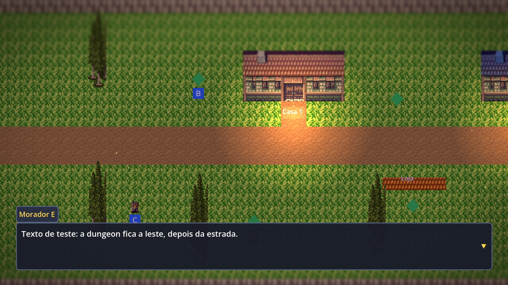
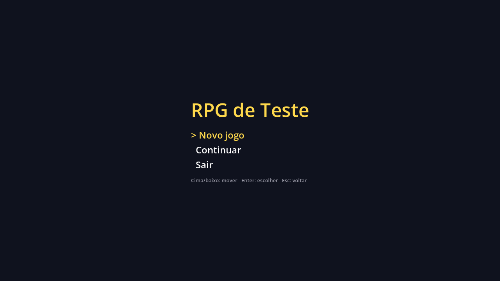
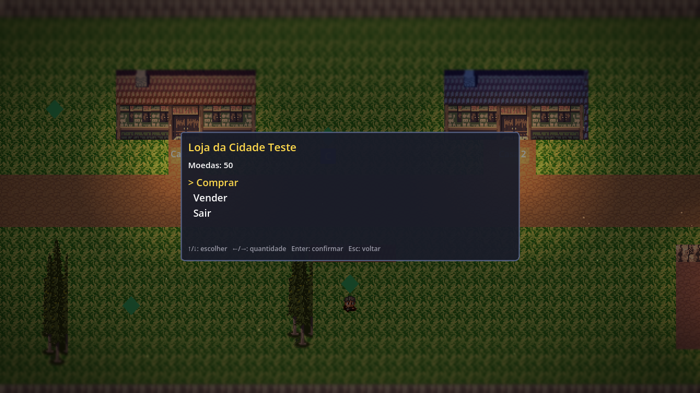
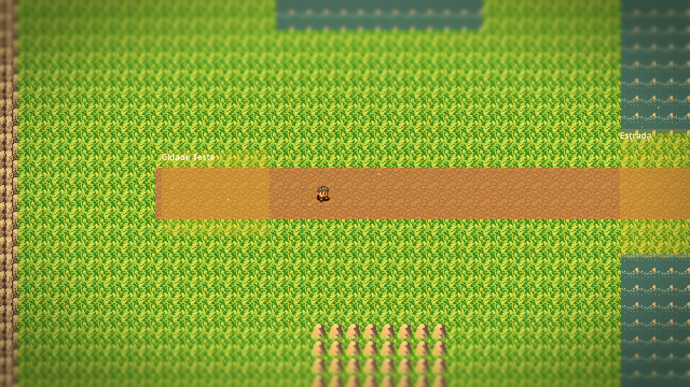
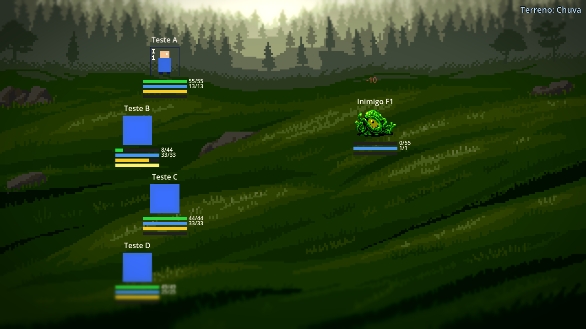
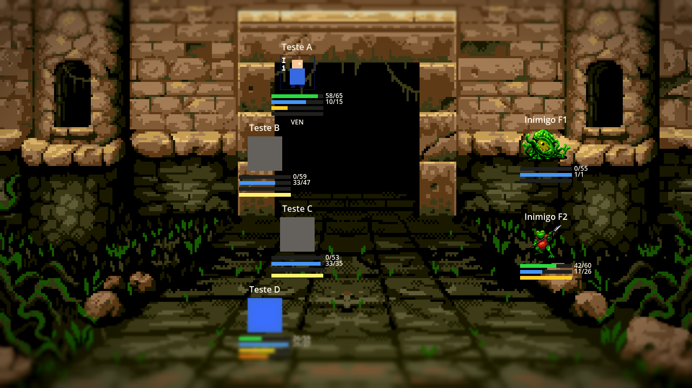
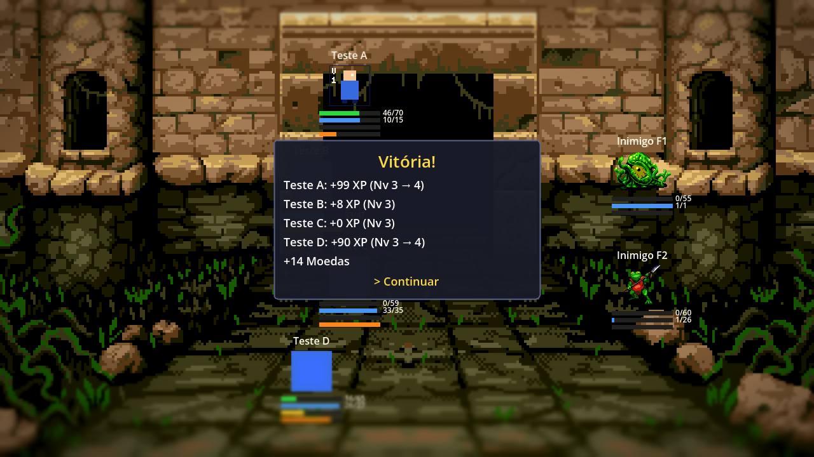

# VAT RPG

RPG de batalha em tempo real por barra de **ATB**, feito em **Godot 4.7** com GDScript tipado. Este é o **MVP jogável**: uma fatia vertical completa, do título ao chefe, com visual pixel art **HD-2D** (luz quente, bloom e desfoque de profundidade em 2D puro).



> Nomes, textos e números da fatia são placeholder de teste. O foco do MVP é provar o ciclo de jogo e as ferramentas de criação.

## Baixar e jogar

Baixe o instalador da versão mais recente em **[Releases](../../releases/latest)**:

| Sistema | Arquivo | Como abrir |
|---|---|---|
| Windows (x64) | `VAT-RPG-<versão>-windows.zip` | Extraia e execute `VAT-RPG.exe` |
| Linux (x86_64) | `VAT-RPG-<versão>-linux-x86_64.tar.gz` | `tar xzf ...` e `./VAT-RPG.x86_64` |

Não precisa instalar o Godot. Os saves ficam na pasta de dados do usuário do sistema (`user://`).

## O que tem no MVP

| | |
|---|---|
|  | **Título e saves.** Novo jogo, Continuar e 3 slots em disco. Salva só em pontos de descanso, pousadas e no mapa-múndi. |
|  | **Cidade viva.** Moradores com diálogo, missões, loja (comprar e vender), pousada paga e recrutamento de heróis. |
|  | **Exploração.** Mapa-múndi, estrada com encontros e inimigos visíveis no mapa. Encostar pelas costas dá vantagem; ser alcançado dá emboscada. |
|  | **Batalha ATB.** Modo Espera ou Ativo, grupo de 4 mais reserva, técnicas por herói, barra de Limite, Suporte, fuga e 9 elementos com fraquezas e reações. |
|  | **Dungeon de dois andares.** Baús, portas e chaves, interruptores, armadilhas, obstáculos elementais e um chefe com fases, ataques anunciados e contra-ataque. |
|  | **Progressão.** XP por contribuição, pontos de atributo para distribuir, equipamentos com passivos, estados (veneno, sono, barreira...) e bestiário. |

Também no pacote: áudio por barramentos (som e música por gatilhos, ainda com sons placeholder) e um **editor visual** dentro do Godot (aba VAT) para criar mapas, eventos, heróis e inimigos sem código.

## Como jogar

**Percurso da demo:** título → cidade → mapa-múndi → estrada → dungeon (andares 1 e 2) → chefe → tela de fim.

| Tecla | Ação |
|---|---|
| Setas / WASD | Andar |
| Shift / X (segurar) | Correr |
| Enter / Espaço / Z | Interagir e confirmar |
| Tab / Esc | Menu de campo; voltar |
| Q (segurar, em batalha) | Fugir |
| F1 | Painel de debug da batalha |

No menu de campo ficam Itens, Técnicas, Equipar, Status, Atributos, Formação, Salvar e Config (modo ATB, velocidade da batalha, texto e volume).

## Rodar a partir do código

Requer [Godot 4.7](https://godotengine.org/download) (>= 4.4).

```bash
git clone https://github.com/alexzjss/vat.git
godot --path vat/game          # ou abra a pasta game/ no editor e aperte F5
```

No Windows: `winget install --id GodotEngine.GodotEngine -e`.

Testes (GUT, sem janela):

```powershell
./run_tests.ps1
```

Para ver a fatia inteira rodar sozinha: `godot --path game -- --demo-fatia`.

## Gerar os instaladores

O workflow [`.github/workflows/release.yml`](.github/workflows/release.yml) roda os testes e exporta o jogo para Windows e Linux com os presets de [`game/export_presets.cfg`](game/export_presets.cfg).

- **Release:** crie e envie uma tag, por exemplo `git tag v0.1.0 && git push origin v0.1.0`. Os arquivos aparecem em Releases.
- **Teste sem publicar:** rode o workflow manualmente em *Actions > Build e Release > Run workflow*; os arquivos saem como artefato da execução.

Para exportar localmente, instale os export templates 4.7.2 no editor e rode, em `game/`:

```bash
godot --headless --export-release "Windows Desktop" ../build/windows/VAT-RPG.exe
godot --headless --export-release "Linux" ../build/linux/VAT-RPG.x86_64
```

## Estrutura

| Pasta | Conteúdo |
|---|---|
| `game/core/` | Regras de combate puras (sem nós nem Input), testáveis |
| `game/battle/` | Apresentação da batalha |
| `game/world/` | Jogo raiz, mapas, jogador, inimigos de mapa, eventos |
| `game/data/` | Dados em `.tres`: `test/` e `fatia/` |
| `game/addons/vat_editor/` | Editor visual (aba VAT) |
| `game/tests/` | Testes GUT |
| `docs/` | [Referência técnica](docs/referencia-tecnica.md), [roadmap](docs/roadmap.md), [guia de criação](docs/guia-criacao.md), [estilo HD-2D](docs/guia-estilo-hd2d.md), [roteiro](docs/roteiro.md), [balanceamento](docs/balance/) |

## Estado e próximos passos

Marcos M1 a M20 prontos: batalha ATB, mapa, eventos, fatia vertical, elementos, marcas e reações, estados e bestiário, editores visuais, áudio e estilo HD-2D. Ainda falta: sons e música definitivos, sprites próprios para os heróis de batalha (hoje são blocos), conteúdo narrativo e balanceamento final. Veja o [roadmap](docs/roadmap.md).

## Créditos

- Arte de mapa e batalha: *Tiny RPG Fantasy* e fundos de **ansimuz** (Luis Zuno), licença CC0.
- Motor: [Godot Engine](https://godotengine.org) (MIT). Testes: [GUT](https://github.com/bitwiseme/Gut).
